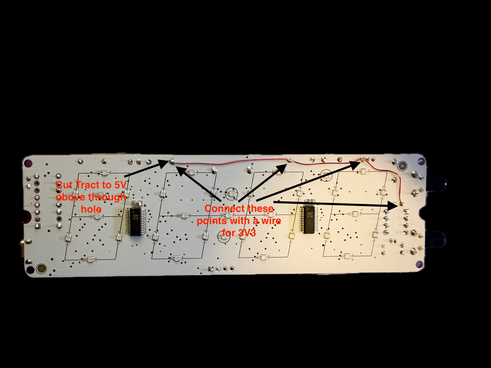
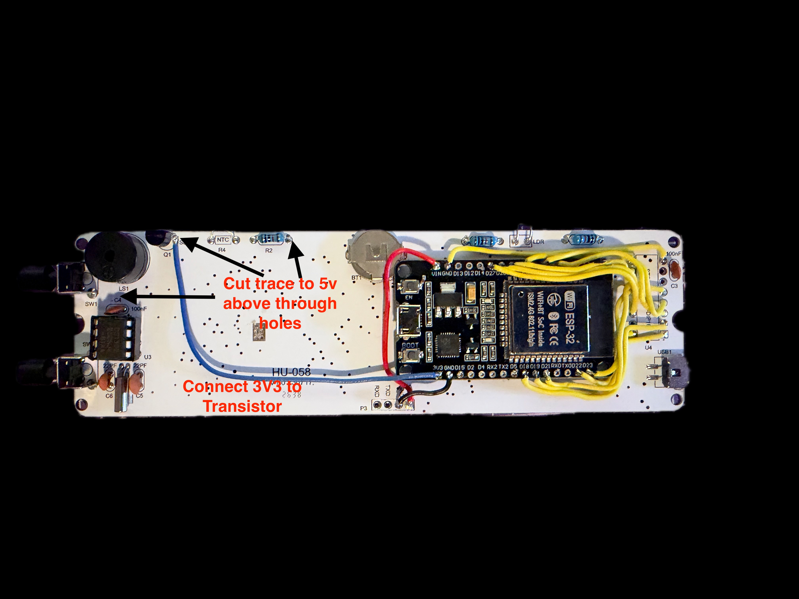

# HU-058 standalone Wi-Fi clock

Firmware for the ESP32-WROOM-32 conversion of the HU-058D, HU-058, and HU-058SE. The ESP32 runs the display, gets local time from SNTP, and hosts a password-protected control page. ESPHome is the firmware build tool. No Home Assistant server is required.

## Wiring

Use the existing ESP32 conversion wiring. For a stock kit, follow the [upstream board preparation and power wiring](https://github.com/misterblack1/HU-058_ESPHome/blob/ceced3c44127c470812991a915b73956226269b7/docs/wiring.md) first.

| Signal | ESP32 | Connects to |
| --- | --- | --- |
| Driver 1 CLK | GPIO22 | Original MCU socket pin 14 on HU-058D, 16 on HU-058 / HU-058SE |
| Driver 1 DATA | GPIO21 | Original MCU socket pin 5 |
| Driver 2 CLK | GPIO19 | Original MCU socket pin 1 |
| Driver 2 DATA | GPIO18 | Original MCU socket pin 2 |
| Top button S1 | GPIO32 | Original MCU socket pin 9 |
| Bottom button S2 | GPIO33 | Original MCU socket pin 10 |
| Buzzer control | GPIO25 | Original MCU socket pin 11, to the S8550 base resistor |
| Indoor NTC thermistor | GPIO34 | Original MCU socket pin 3, at the thermistor divider junction |
| 5539 light sensor | GPIO35 | Original MCU socket pin 4, at the LDR divider junction |
| DS1302 chip enable | GPIO27 | DS1302 pin 5 (CE) |
| DS1302 data | GPIO26 | DS1302 pin 6 (I/O) |
| DS1302 serial clock | GPIO23 | DS1302 pin 7 (SCLK) |
| Common ground | GND | Original MCU socket pin 8 and DS1302 pin 4 |
| Sensor and buzzer supply | 3V3 | Rewired supply pads for the two divider pull-ups and S8550 emitter circuit |

### Move the three circuits to 3.3 V

Disconnect power before cutting or soldering. These annotated photos show the cuts and jumpers for the board pictured. Verify the traces on your board if its layout differs.

1. **Side A (display side).** Cut the 5 V trace just above the marked through-hole. Join all three marked through-hole pads with insulated jumper wire, as shown in red.

   

2. **Side B (component side).** Cut the two 5 V traces marked above the through-holes near Q1 and R2. Connect the ESP32 **3V3** pin to the marked supply pad at the buzzer transistor, as shown in blue. Together with the Side A jumpers, this feeds the buzzer, thermistor, and light sensor from 3.3 V.

   

- **Buzzer:** Feed the S8550 emitter and its base pull-up from **3.3 V**. GPIO25 controls the base through the existing base resistor at socket pin 11.
- **Thermistor:** Feed the supply side of the fixed 10 kΩ divider resistor from **3.3 V**. Socket pin 3 is the divider signal for GPIO34.
- **Light sensor:** Feed the supply side of the fixed 10 kΩ divider resistor from **3.3 V**. Socket pin 4 is the divider signal for GPIO35.

Trace the connections on your board before cutting. Cut only the feeds to these three circuits and keep the display’s 5 V supply intact. With the ESP32 GPIO leads disconnected, verify the rewired supply pads read about 3.3 V and both sensor signal nodes stay within 0–3.3 V relative to common ground. Power off before attaching the GPIO leads.

## DS1302 battery-backed clock

For a bare 8-pin DS1302, identify pin 1 from the package marking and wire it as follows:

| DS1302 pin | Signal | Connect to |
| --- | --- | --- |
| 1 | VCC2 | ESP32 3V3, with a 100 nF bypass capacitor to ground near the IC |
| 2 | X1 | One lead of a 32.768 kHz, 6 pF load watch crystal |
| 3 | X2 | Other crystal lead. Keep both crystal traces short |
| 4 | GND | ESP32 GND and battery negative |
| 5 | CE (sometimes RST) | ESP32 GPIO27 |
| 6 | I/O | ESP32 GPIO26 |
| 7 | SCLK | ESP32 GPIO23 |
| 8 | VCC1 | Positive terminal of a 3 V backup battery, such as a CR2032 |

The firmware disables the DS1302 trickle charger. Keep the main RTC supply and GPIO signals at 3.3 V. If reusing a clock PCB’s RTC footprint, verify its supply and signal traces before connecting the ESP32. The coin cell powers the RTC only. [DS1302 datasheet](../../reference/ds1302-datasheet.pdf)

Set the time once through setup or Administration, or let the clock sync over Wi-Fi. These operations write UTC to the RTC. On boot the firmware reads the RTC, then applies the clock’s timezone. To test backup, disconnect the clock’s main power for a few minutes, leave the coin cell installed, and restart without home Wi-Fi. The display should show the elapsed time. A factory reset invalidates the saved RTC time. Set or sync the time again afterward.

## Build and flash

1. Copy `secrets.yaml.example` to `secrets.yaml`. Set the setup hotspot, web, and OTA passwords. These settings can be shared by all clocks using the same firmware. The example timezone is `America/New_York`. Change it if needed.
2. Install ESPHome and flash over the ESP32's USB serial connection.

   ```sh
   python3 -m venv .venv
   source .venv/bin/activate
   python -m pip install esphome==2026.10.2
   esphome run clock.yaml
   ```

## Set up Wi-Fi on each clock

1. After flashing, join the clock’s password-protected Wi-Fi hotspot from a phone or laptop. Its name has the form `wifi-clock-a1b2c3`, where the last six characters come from that ESP32’s MAC address. Use the `ap_password` from `secrets.yaml`.
2. Open the captive portal, or browse to [192.168.101.1](http://192.168.101.1/) while connected to the hotspot. Select **Connect to Wi-Fi**, then select your home network, enter its password, and submit. The clock saves these credentials on the device. A clock upgrading from the configuration with baked-in Wi-Fi credentials may need this setup once.
3. Rejoin your home network and browse to the clock’s hotspot name followed by `.local`, for example `http://wifi-clock-a1b2c3.local/`. If your network cannot resolve `.local` names, use the clock’s IP address from your router or serial log. On first use, sign in with the web credentials in `secrets.yaml`.

Flash the same firmware on each clock and repeat setup for each device. Its setup hotspot returns if it cannot connect to the saved network, so you can enter new credentials there.

For subsequent wireless updates, target the specific clock with `esphome run clock.yaml --device wifi-clock-a1b2c3.local`, substituting its hostname or IP address. For the first wireless upgrade from the earlier configuration, target the existing IP address and reuse the current firmware’s OTA password.

## Use the clock without Wi-Fi

Join the clock’s setup hotspot and open [192.168.101.1](http://192.168.101.1/). Under **Use Offline**, choose your timezone, verify the date and time, and select **Set time and use offline**. The time field starts with your phone or computer’s local time. Adjust it if it differs from the timezone you selected.

The clock keeps time while powered. An initialized DS1302 with a backup battery also preserves time across power loss. Without one, set the time again or connect to Wi-Fi for time sync. To go online later, rejoin the setup hotspot and select **Connect to Wi-Fi**.

## Recover from an incorrect Wi-Fi password

The setup portal’s **Saved. Connecting…** message confirms that it received the credentials. To verify the connection, check that the clock appears in your router’s device list and that its web page opens from your home network.

1. If the clock cannot join, leave it powered for about two minutes so its fallback hotspot can return. If needed, power-cycle it and wait again.
2. Join the clock’s setup hotspot, `wifi-clock-xxxxxx`, using the `ap_password` from the firmware build. Stay connected if your phone or laptop warns that the hotspot has no internet.
3. Open [192.168.101.1](http://192.168.101.1/) select **Connect to Wi-Fi**, and re-enter the password for your 2.4 GHz Wi-Fi network.
4. Rejoin your home Wi-Fi and open the clock’s current address. After a factory reset, use `http://wifi-clock-xxxxxx.local/` with the clock’s actual MAC suffix, or open the IP address listed by your router.

If the hotspot still does not appear, connect the ESP32 over USB. From this firmware directory, with ESPHome active, run `esphome logs clock.yaml --device /dev/cu.usbserial-3120`. Substitute your USB serial port from `ls /dev/cu.*`. The logs can show authentication failures, a successful connection, or the fallback hotspot starting.

## Administration

Open **Administration** at the top of the clock’s web page.

- **Save hostname** sets the exact name and restarts the clock. Enter `brian-clock` to use `brian-clock.local` for web access and OTA. Use up to 30 letters, digits, or hyphens, with a letter or digit at each end. Leave blank to restore the default `wifi-clock-xxxxxx` name.
- **Save domain** sets the suffix used in the clock’s displayed address. The default is `local`. For a custom suffix such as `home.arpa`, configure your router or DNS server to resolve the full name to the clock. The clock still advertises its `.local` name over mDNS.
- **Reset All Settings** erases saved Wi-Fi credentials, web login, hostname, domain, timezone override, alarm, display, and sensor settings. The installed firmware and its build-time defaults remain in place. After restart, join the default `wifi-clock-xxxxxx` hotspot with the original setup password and open [192.168.101.1](http://192.168.101.1/) to provision Wi-Fi again. After setup, rejoin your home network and open the default hostname followed by `.local`, or use the clock’s current IP from your router. Sign in with the original web credentials from the firmware build.

- **Save timezone** selects a US timezone or UTC and saves it on this clock. Zones that observe daylight saving adjust automatically. The firmware timezone applies until you save a selection.
- **Set Local Date and Time** sets the clock using the selected timezone. Save the timezone first.
- **Save Wi-Fi** saves the selected network on this clock and restarts it. Rejoin the new network and use the clock’s same hostname or find its new IP in your router. If the clock cannot connect, use its setup hotspot at [192.168.101.1](http://192.168.101.1/).
- **Save login** stores the new username and password on this clock and restarts it. Sign in again with the new login. The username accepts letters, digits, periods, underscores, and hyphens. Use a password of 8–64 printable ASCII characters. The values in `secrets.yaml` are the initial login for a fresh device.
- The clock serves its web page over local HTTP. Change credentials from a trusted network.

## Controls

- **Display** controls power, RGB color, and brightness. The first-boot brightness is 50%.
- **12 Hour Time** and **Blink Colon** control the time format and colon. The top button shows outdoor temperature for five seconds. The bottom button blanks the display until pressed again. **Blank Display** shows and controls that state. Use **Show Seconds** on the web page to see seconds.
- The web page provides color cycle and flash settings, a per-digit color demo, a diagonal gradient preset, a lamp test, and temporary number display with an optional C or F unit. These named controls also have ESPHome HTTP endpoints. The upstream Home Assistant actions for arbitrary per-digit colors, per-LED colors, and custom gradient endpoints have no standalone equivalent here.
- After an initial SNTP sync, the clock continues counting time through a Wi-Fi outage. A cold boot displays dashes until it can sync. The fallback Wi-Fi setup network uses the configured access point password.

## Manual time, alarm, and display schedule

- **Set Local Date and Time** in Administration sets the ESP32 clock in the configured timezone. After a Wi-Fi sync or a manual setting, the clock, alarm, and schedule keep running without Wi-Fi while powered. SNTP can correct the time when the network is available. After an offline restart, an initialized DS1302 restores the time. Without a valid RTC time, use offline setup to set it again.
- Open the **Alarm** tab, set **Daily alarm time**, select **Enable daily alarm**, and save. Clear **Enable daily alarm** to turn it off indefinitely, or select **Skip next alarm** to skip one occurrence while keeping the daily alarm enabled. Set **Alarm duration** from 1 to 300 seconds. The default is 30 seconds. Press the bottom button or **Silence Alarm** to stop it.
- Set **Scheduled Display On** and **Scheduled Display Off**, then turn on **Enable Display Schedule**. The schedule can span midnight. Equal times keep the display on. The bottom button overrides blanking until the next scheduled transition.

### Buzzer

In **Alarm**, set **Volume** from 0 to 100% and **Tone Frequency** from 1000 to 5000 Hz. The defaults are 100% and 2500 Hz. Save before using **Test Buzzer** to compare tones.

The firmware drives an S8550 PNP high-side switch and releases GPIO25 between beeps so the pull-up holds the transistor off. Verify the transistor’s pinout, then connect its emitter to ESP32 3.3 V, its collector to buzzer positive, and buzzer negative to ESP32 ground. Connect GPIO25 to the base through 1 kΩ and the base to 3.3 V through 10 kΩ. For a magnetic buzzer, put a flyback diode across it with the stripe toward the collector. Use the ESP32’s 3.3 V rail with this circuit.

## Automatic display brightness

Wire the 5539 light-dependent resistor and a 10 kΩ resistor as a divider:

```text
ESP32 3V3 ── 10 kΩ ────┬── 5539 LDR ── ESP32 GND
                         │
                      GPIO35
```

Use the ESP32's 3.3 V supply. The LDR is nonpolar. Mount it where it can see room light without facing the clock's LEDs.

After flashing, check that **Ambient Light Voltage** falls when you shine light on the sensor, then turn on **Automatic Brightness** in Controls. It is off by default, so clocks without an LDR still use manual brightness. When enabled, the **Display** brightness slider sets the bright-room level. The firmware dims below that level as ambient light falls and smooths changes over several seconds. **Current Auto Brightness** shows the resulting setting from 1 to 100 while the display and automatic brightness are on. Display power and scheduled blanking still apply. Lamp tests and temperature readouts use the same brightness and blanking settings.

## Indoor temperature

```text
ESP32 3V3 ── 10 kΩ ──┬── NTC thermistor ── ESP32 GND
                      │
                    GPIO34
```

Keep the light sensor on GPIO35. The original board uses separate inputs for both sensors and pulls its thermistor divider up to 5 V. Use the 3.3 V divider above when connecting to GPIO34. If reusing the original board divider, isolate its pull-up from 5 V and connect it to 3.3 V before attaching GPIO34.

For troubleshooting, measure each socket node relative to ESP32 GND with its GPIO signal lead disconnected. Confirm the pull-up supply is 3.3 V. The upstream socket map identifies pin 3 as NTC and pin 4 as LDR. Trace your board's resistors or measure the response to light and warmth before assigning either wire. A stock-style LDR on the ground side reads lower in brighter light. The firmware expects that falling voltage as the room gets brighter. In Controls, **Thermistor Input Voltage** shows the ADC reading even when **Indoor Temperature** is unavailable. A 10 kΩ NTC with a 10 kΩ pull-up should read roughly 1.65 V at 25 °C.

The firmware assumes a 10 kΩ NTC at 25 °C with beta 3950. Set `thermistor_r25` and `thermistor_beta` in `indoor_temperature.yaml` for your part. Mount it away from the ESP32 and display heat.

One press of Button 1 shows outdoor temperature for three seconds, then indoor temperature for three seconds. An unavailable reading is skipped. Use **Indoor Temperature Offset** to match a nearby reference thermometer after both readings stabilize. For a 45 °F reading in a 72 °F room, enter +27 °F. If the error changes substantially with room temperature, verify the thermistor and divider values.

## Outdoor temperature

On the clock’s web page, enter a five-digit US ZIP code in **Weather ZIP Code** and submit it. The clock saves the ZIP across reboots. Check **Weather Status** and **Outdoor Temperature** to see when a reading is available.

Use **Test Button 1 - Show Temperature** and **Test Button 2 - Toggle Display Blank** to run the same actions from the web page. **Test Temperature Digits** shows a fixed sample of 72° using the same renderer, so you can confirm the firmware update and display layout before testing the ZIP lookup. Unblank the display before either temperature test.

The clock looks up the ZIP using [Zippopotam.us](https://docs.zippopotam.us/docs/getting-started/) and fetches current outdoor conditions from [Open-Meteo](https://open-meteo.com/en/docs). It refreshes about every 15 minutes and shows the temperature rounded to the nearest degree Fahrenheit. If the reading is missing or at least 30 minutes old, pressing the top button tries to fetch a fresh one. If that fails, the display stays on the time.

The display component and GPIO mapping come from [misterblack1/HU-058_ESPHome](https://github.com/misterblack1/HU-058_ESPHome/tree/ceced3c44127c470812991a915b73956226269b7). See the included license.

## Firmware versioning

Administration shows the revision compiled into the installed firmware. Before publishing a new firmware revision, update `firmware_version` in `clock.yaml`. Use major versions for breaking changes, minor versions for backward-compatible features, and patch versions for fixes.
